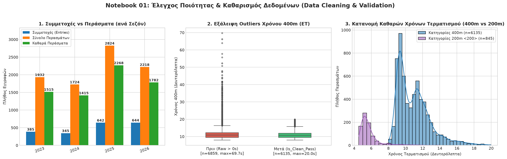
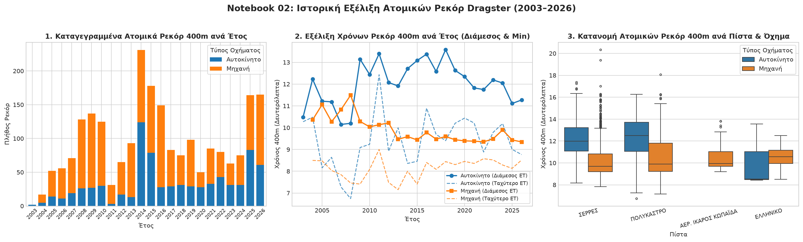
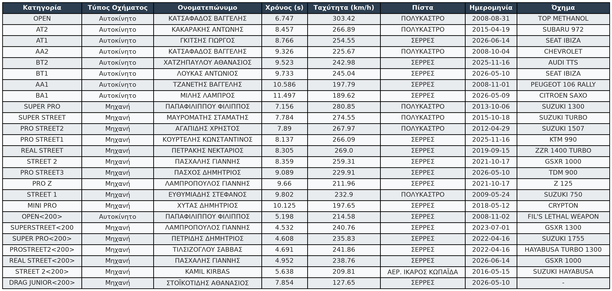

# LENOE_stats - Στατιστική Ανάλυση Πανελλήνιου Πρωταθλήματος Dragster

Σύστημα εξαγωγής, καθαρισμού και στατιστικής ανάλυσης των ιστορικών δεδομένων χρονομέτρησης (Timeslips, Συμμετοχές και Ρεκόρ) του Πανελλήνιου Πρωταθλήματος Dragster. Το project ενοποιεί τις βάσεις δεδομένων Microsoft Access (`.mdb`) ανά αγωνιστική σεζόν σε καθαρά σύνολα δεδομένων (`.csv`) και πραγματοποιεί ελέγχους εγκυρότητας και στατιστική ανάλυση απόδοσης.

---

## Δομή του Project (Project Structure)

```text
LENOE_stats/
|
├── dashboard/                              # Οδηγίες και αρχεία ενσωμάτωσης του Dashboard
|   └── embed_instructions.md               # Οδηγίες ενσωμάτωσης (iframe) σε ιστοσελίδα
|
├── data/
|   ├── raw/                                # Ακατέργαστα αρχεία βάσεων .mdb ανά έτος *(gitignored)*
|   |   └── Drag2026.mdb                    # Βάση δεδομένων αγωνιστικής σεζόν
|   |
|   └── processed/                          # Καθαρισμένα και ενοποιημένα αρχεία .csv *(gitignored)*
|       ├── clean_entries.csv               # Καθαρές συμμετοχές αγώνων
|       ├── clean_records.csv               # Ιστορικά ρεκόρ κατηγοριών (2003-2026)
|       └── clean_results.csv               # Καθαρά περάσματα χρονομέτρησης (Timeslips)
|
├── docs/                                   # Τεκμηρίωση και προδιαγραφές του project
|   ├── data_dictionary.md                  # Λεξικό δεδομένων και επεξήγηση στηλών βάσης *(gitignored)*
|   └── PRD_LENOE_stats.md                  # Product Requirements Document (Πλάνο Project)
|
├── notebooks/                              # Jupyter Notebooks καθαρισμού και στατιστικής ανάλυσης
|   └── 01_data_cleaning_and_validation.ipynb # Έλεγχος πληρότητας, Waterfall Audit & επικύρωση φίλτρων
|
├── outputs/
|   └── figures/                            # Εξαγόμενα γραφήματα υψηλής ανάλυσης (.png)
|       └── 01_data_cleaning_validation.png # Γράφημα ελέγχου ποιότητας και καθαρισμού δεδομένων
|
├── scripts/                                # Αυτοματοποιημένα scripts επεξεργασίας δεδομένων
|   └── build_master_dataset.py             # Script εξαγωγής .mdb, καθαρισμού και ένωσης πινάκων
|
├── .gitignore                              # Κανόνες εξαίρεσης αρχείων από το Git
├── README.md                               # Κεντρικός οδηγός περιγραφής και εκτέλεσης του project
└── requirements.txt                        # Απαραίτητες βιβλιοθήκες Python
```

---

## Εγκατάσταση & Προαπαιτούμενα (Setup)

1. Δημιουργία και ενεργοποίηση εικονικού περιβάλλοντος Python (προαιρετικά):
   ```bash
   python -m venv venv
   venv\Scripts\activate
   ```
2. Εγκατάσταση των απαραίτητων βιβλιοθηκών από το `requirements.txt`:
   ```bash
   pip install -r requirements.txt
   ```

---

## Οδηγός Εκτέλεσης & Ροή Εργασιών (Workflow Guide)

### Βήμα 1: Εξαγωγή & Δημιουργία Καθαρών Datasets (`scripts/build_master_dataset.py`)

Το script `build_master_dataset.py` αναλαμβάνει την ανάγνωση των πρωτογενών βάσεων δεδομένων χρονομέτρησης, τον καθαρισμό τους και την παραγωγή των τελικών αρχείων ανάλυσης.

#### Πώς τρέχει:
1. Τοποθέτησε ένα ή περισσότερα αρχεία βάσεων δεδομένων Microsoft Access (`.mdb`) μέσα στον φάκελο `data/raw/` με ομοιογενή ονοματολογία ανά έτος (π.χ. `Drag2025.mdb`, `Drag2026.mdb`). *(Σε περίπτωση που δεν υπάρχουν αρχεία `.mdb`, το script διαθέτει αυτόματο fallback για ανάγνωση εξαγόμενων πινάκων `.xlsx` από τον ίδιο φάκελο).*
2. Από τον κεντρικό φάκελο του project (`LENOE_stats`), εκτέλεσε στο τερματικό:
   ```bash
   python scripts/build_master_dataset.py
   ```

#### Τι κάνει το script στο παρασκήνιο:
* **Ανάγνωση χωρίς ODBC Drivers:** Διαβάζει απευθείας τους 9 απαραίτητους πίνακες (`Results`, `Entries`, `Sessions`, `Drivers`, `Races`, `Tracks`, `Classes`, `Valid`, `Records`) από κάθε αρχείο `.mdb` χρησιμοποιώντας τη βιβλιοθήκη καθαρής Python `access-parser`, αποφεύγοντας προβλήματα συμβατότητας 32-bit/64-bit του Microsoft Office.
* **Ενοποίηση Πινάκων & Μοναδικό Κλειδί Αγώνα (`Race_UID`):** Ενώνει τους πίνακες κάθε σεζόν εσωτερικά και δημιουργεί το σύνθετο κλειδί `Race_UID` (π.χ. `Drag2026_R2`), ώστε να μη συγχέονται οι κωδικοί αγώνων (`ααΑγώνα = 1, 2, 3...`) μεταξύ διαφορετικών ετών.
* **Φιλτράρισμα Ακυρωμένων Συμμετοχών:** Αφαιρεί αυτόματα από τον πίνακα `Entries` όσες εγγραφές έχουν το γράμμα `Χ` (ελληνικό ή λατινικό, κεφαλαίο ή πεζό: `Χ, χ, X, x`) μπροστά από τον αριθμό αγωνιζόμενου (`αρΑγωνιζόμενου`), οι οποίες αντιστοιχούν σε μη-πραγματικές συμμετοχές.
* **Μετατροπή Μονάδων Μέτρησης:** Μετατρέπει όλους τους χρόνους του πίνακα `Results` (`ΧρόνοςΑντίδρασης`, `Χρόνος18`, `Χρόνος100`, `Χρόνος190`, `Χρόνος200`, `Χρόνος290`, `Χρόνος300`, `Χρόνος390`, `Χρόνος400`) από ακέραια χιλιοστά του δευτερολέπτου (`ms`) σε δεκαδικά δευτερόλεπτα (`_sec`).
* **Δημιουργία Αναλυτικών Μεταβλητών (Feature Engineering):**
  * `Net_RT_sec`: Καθαρός χρόνος αντίδρασης πάνω στο Pro Tree (`ΧρόνοςΑντίδρασης_sec - 0.400`).
  * `Απόσταση_Κατηγορίας_m`: Αυτόματος διαχωρισμός των κατηγοριών ανά απόσταση τερματισμού (`400m`, `200m` για τις κατηγορίες `<200>`).
  * `BackHalf_200_400_sec` & `Speed_Gain_200_400_kmh`: Χρόνος 2ου μισού πίστας (`200m-400m`) και κέρδος ταχύτητας εξόδου.
  * `Is_Clean_Pass`: Λογικό φίλτρο (`True/False`) που απομονώνει τα καθαρά αγωνιστικά περάσματα (αφαιρεί τις δοκιμές συστήματος `ΠΙΣΤΑ == 'ΔΟΚΙΜΕΣ'`, τα άκυρα περάσματα `Εγκυρη != 0`, τις εγκαταλείψεις και τις δυσλειτουργίες φωτοκυττάρων).
* **Εξαγωγή Αρχείων:** Αποθηκεύει στον φάκελο `data/processed/` τα 3 καθαρά αρχεία σε κωδικοποίηση `utf-8-sig`:
  1. `clean_results.csv`
  2. `clean_entries.csv`
  3. `clean_records.csv` (λαμβάνεται από την πιο πρόσφατη βάση, καθώς περιέχει σωρευτικά όλο το ιστορικό ατομικών ρεκόρ 2003–2026).

---

### Βήμα 2: Έλεγχος Ποιότητας & Επικύρωση Δεδομένων (`notebooks/01_data_cleaning_and_validation.ipynb`)

Το πρώτο Jupyter Notebook φορτώνει τα παραγόμενα αρχεία από το `data/processed/` και εκτελεί ελέγχους ακεραιότητας, πληρότητας και στατιστικής επίδρασης του καθαρισμού.

#### Πώς τρέχει:
Άνοιξε το αρχείο `notebooks/01_data_cleaning_and_validation.ipynb` στο VS Code (ή μέσω `jupyter notebook`) και εκτέλεσε τα 6 κελιά με τη σειρά.

#### Τι περιλαμβάνει ανά κελί:
1. **Κελί 1 - Φόρτωση & Διαστάσεις Datasets:** Φορτώνει τα `clean_results.csv`, `clean_entries.csv` και `clean_records.csv` και επιβεβαιώνει το πλήθος εγγραφών και στηλών.
2. **Κελί 2 - Διασταύρωση Αγώνων (`Race_UID` Audit):** Συγκρίνει τις πραγματικές συμμετοχές (`Entries`), το σύνολο των περασμάτων (`Results`) και τα καθαρά περάσματα (`Is_Clean_Pass`) ανά αγώνα. Εντοπίζει τις δοκιμές συστήματος (`ΔΟΚΙΜΕΣ`) καθώς και αγώνες που έχουν δηλωμένες συμμετοχές αλλά δεν έχουν ακόμα καταγεγραμμένα περάσματα.
3. **Κελί 3 - Έλεγχος Ορφανών Εγγραφών (`ααΣυμμετοχής == 0`):** Επιβεβαιώνει ότι τα περάσματα χωρίς αντιστοίχιση οδηγού αφορούν αποκλειστικά εικονικές εγγραφές `Αναγκαστ.Bye` (`Εγκυρη == -5`) σε μονά περάσματα (Bye Runs) των Eliminations.
4. **Κελί 4 - Κατανομή Κωδικών Εγκυρότητας (`Valid`):** Υπολογίζει τη συχνότητα όλων των κωδικών εγκυρότητας (`Έγκυρος`, `ΌριοΧρόνου / Breakout`, `Εγκατέλειψε`, `Άκυρος / Red Light`, `Δεν προσήλθε`, `ΆκΔιαδρομή`) και επαληθεύει ότι ο κωδικός `1.0` (`ΝΑΑγώνα` = Νικητής Άνευ Αγώνα) έχει μηδενικούς χρόνους (`0.0s`).
5. **Κελί 5 - Waterfall Audit & Στατιστική Σύγκριση (Raw vs Clean):**
   * Παρουσιάζει αναλυτικό πίνακα διαρροής (Waterfall Audit) που δείχνει πόσα ακριβώς περάσματα αφαιρούνται σε κάθε επιμέρους βήμα του φίλτρου `Is_Clean_Pass`.
   * Συγκρίνει τα περιγραφικά στατιστικά (`Count`, `Mean`, `Median`, `Std`, `Min`, `Max`) πριν (`Raw`) και μετά (`Clean`) τον καθαρισμό, τεκμηριώνοντας τη μείωση της τυπικής απόκλισης μετά την αφαίρεση των εγκαταλείψεων.
6. **Κελί 6 - Οπτικοποίηση Καθαρισμού:** Παράγει και αποθηκεύει το συγκεντρωτικό γράφημα ελέγχου στο `outputs/figures/01_data_cleaning_validation.png`:



---

### Βήμα 3: Ιστορική Ανάλυση Προσωπικών Ρεκόρ & Ρεκόρ Κατηγοριών (`notebooks/02_historical_trends_analysis.ipynb`)

Το δεύτερο Jupyter Notebook αναλύει το αρχείο `clean_records.csv` (2003–2026) σε δύο μέρη: **(Α) Προσωπικά Ρεκόρ (Personal Bests)** όλων των οδηγών και **(Β) Απόλυτα Ρεκόρ ανά Κατηγορία (All-Time Class Records)** για τις κατηγορίες χωρίς όριο χρόνου.

#### Μέρος Α - Ανάλυση Προσωπικών Ρεκόρ (Κελιά 1–6):
1. **Κελί 1 - Διαχωρισμός Αποστάσεων (`400m` vs `200m`):** Φιλτράρει τα προσωπικά ρεκόρ `400m` και `200m` για Αυτοκίνητα και Μηχανές.
2. **Κελί 2 - Περιγραφικά Στατιστικά ανά Τύπο Οχήματος:** Συγκρίνει τους χρόνους τερματισμού και τις ταχύτητες εξόδου μεταξύ Αυτοκινήτων και Μηχανών.
3. **Κελί 3 - Πίνακας "Hall of Fame" (Top 5 Όλων των Εποχών):** Εντοπίζει τις 5 ταχύτερες επιδόσεις 400m στην ιστορία του θεσμού για Αυτοκίνητα και Μηχανές.
4. **Κελί 4 - Σύγκριση Πιστών (`ΣΕΡΡΕΣ`, `ΠΟΛΥΚΑΣΤΡΟ`, `ΑΕΡ. ΙΚΑΡΟΣ ΚΩΠΑΪΔΑ`, `ΕΛΛΗΝΙΚΟ`):** Ομαδοποιεί τα προσωπικά ρεκόρ ανά πίστα και συγκρίνει την ενεργή περίοδο, το πλήθος ρεκόρ και τις επιδόσεις.
5. **Κελί 5 - Έλεγχος Διαχρονικής Τάσης (Spearman Rank Correlation):** Εφαρμόζει μη-παραμετρικό έλεγχο συσχέτισης Spearman (`scipy.stats.spearmanr`) για την ποσοτικοποίηση της πτώσης των χρόνων και της αύξησης των ταχυτήτων ανά έτος.
6. **Κελί 6 - Οπτικοποίηση Προσωπικών Ρεκόρ:** Παράγει και αποθηκεύει το γράφημα `outputs/figures/02_historical_trends.png`:



#### Μέρος Β - Πίνακας Απόλυτων Ρεκόρ ανά Κατηγορία (Κελί 7):
7. **Κελί 7 - All-Time Class Records Board & Κατοχή ανά Πίστα:** Φιλτράρει τις αγωνιστικές κατηγορίες χωρίς όριο χρόνου (`Όριοχρόνου == 0`, εξαιρώντας τα Free Pass και τις ελεύθερες δοκιμές) και εμφανίζει:
   * Τον συγκεντρωτικό πίνακα με το ρεκόρ κάθε κατηγορίας (**Κατηγορία, Τύπος Οχήματος, Ονοματεπώνυμο, Χρόνος, Ταχύτητα, Πίστα, Ημερομηνία, Όχημα**).
   * Τον πίνακα κατανομής που δείχνει ποια πίστα κατέχει τα περισσότερα ρεκόρ κατηγοριών.


